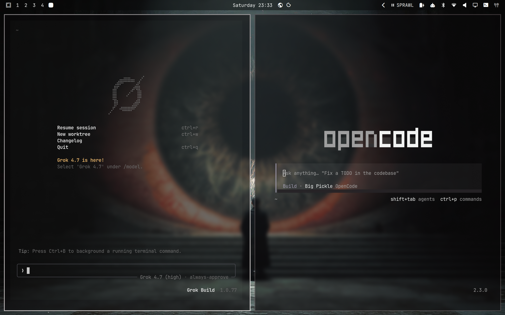
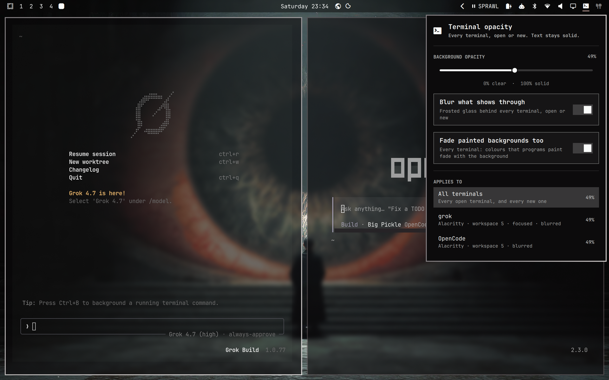

# Terminal opacity

An Omarchy bar widget with one slider for the background opacity of every
terminal, or of one window. Terminals change live as the slider moves, and the
text stays solid. 100% is a solid background, 0% is clear.


The background at 49%, with what is behind showing through sharp.



The same with **Blur what shows through** on.



The panel: the slider, the two switches, and what the slider applies to.

## Using it

- Click the bar icon, pick **All terminals** or one window, and drag.
- Scroll on the bar icon to nudge the focused terminal by 5.
- In the panel: Up/Down picks a target, Left/Right changes it by 5, Enter
  flips its blur.
- **Blur what shows through** turns on frosted glass behind whatever is
  picked: every terminal, or one window until it closes. It is off at first,
  so what is behind a terminal shows through sharp. If Hyprland's own blur is
  off, a **Turn on Hyprland's blur** button appears under it (see [Blur](#blur)).
- **Fade painted backgrounds too** fades the solid colours that programs
  paint, such as the panels of a CLI harness. It is one choice for every
  terminal, and off at first.
- **Follow the theme again** forgets the opacity saved here. It leaves the
  blur choice alone.

**All terminals** saves a default. New terminals open with it, and it survives
theme changes. One window's value is its own until that window closes.

## Blur

Hyprland blurs what shows through a see-through window whenever its blur is
on, which Omarchy's Glassy look does. The widget tells each terminal window
not to blur (`no_blur`) unless the switch is on for it. One window's choice is
always just that window, even where its opacity is shared with its process.

**Omarchy ships with Hyprland's blur off**, and the switch cannot blur anything
until it is on. While it is off and blur is wanted, the panel shows a **Turn on
Hyprland's blur** button. It runs `omarchy hyprland window transparency glassy`,
Omarchy's Glassy look, which also blurs the bar and menus and fades Nautilus a
little. The same from a terminal:

```sh
terminal-opacity glassy
```

To go back: `omarchy hyprland window transparency transparent`.

## Painted backgrounds

A terminal fades only its own default background, so a colour a program
paints stays solid. The switch asks each terminal to fade those too:

| Terminal | Setting | When |
|---|---|---|
| Foot | `alpha-mode=all` | windows opened after the switch |
| Ghostty | `background-opacity-cells` | live |
| Alacritty | `transparent_background_colors` | live |
| Kitty | `transparent_background_colors`, listed colours only | live |

They fade to the same opacity as the background; only Kitty can give a colour
its own. Everything painted fades, selection and status bars included.

Foot reads this only when a window opens. Foot windows opened before the
switch last changed are marked **reopen to apply** in the panel, and the
switch says how many there are, until they are closed.

Kitty has no setting for every colour. List the ones to fade, up to seven, in
`~/.config/kitty/transparency-colors`, one per line, as `#1f2335` or
`#1f2335@0.4` for its own opacity. To find what a program paints, run it
through the widget, use it for a moment and quit:

```sh
terminal-opacity colors grok
```

Then flip the switch off and on so Kitty rereads the list.

## How each terminal is driven

| Terminal | How | Scope | Text |
|---|---|---|---|
| Foot | OSC 11 with an alpha, written to the window's pty | one window | solid |
| Ghostty | include file, then `SIGUSR2` to one process | one process | solid |
| Kitty | include file, then `SIGUSR1` to one process | one process | solid |
| Alacritty | `alacritty msg config` on its IPC socket | one process | solid |
| anything else | Hyprland's opacity for that window | one window | fades too |

A window counts as a terminal if it carries Omarchy's `terminal` tag, is one of
the four above, or its process holds a pty. That last test is what picks up
terminals nobody listed.

A terminal with no background-only control can only fade as a whole window, so
its text fades with it. The panel marks those rows "fades text too", and they
stop at 10% so the window never disappears.

Terminals with their own control are pinned to full Hyprland opacity, so
Omarchy's whole-window fade no longer dims their text.

Tested on Foot 1.28, Kitty 0.49, Ghostty 1.4 and Alacritty 0.17.

## Install on another machine

```sh
git clone https://github.com/ben-chitin/terminal-opacity ~/.config/omarchy/plugins/bhj.terminal-opacity
~/.config/omarchy/plugins/bhj.terminal-opacity/terminal-opacity install
```

That puts the widget in the bar and adds a theme-set hook that puts the saved
values back after a theme change. If the bar shows no icon, run
`omarchy restart shell`. Upgrading from version 1 removes its old
`20-terminal-transparency` hook, which no longer works.

**For blur, turn on Hyprland's blur too.** Omarchy has it off by default, and
`install` says so when it is. Use the button in the panel, or run
`terminal-opacity glassy` (see [Blur](#blur)).

The first change adds one include line to each terminal config that exists
(`foot.ini`, `ghostty/config`, `kitty.conf`, `alacritty.toml`) and writes a
`transparency*` file beside it. Ghostty's include also turns off its
"Reloaded the configuration" toast, which would otherwise show on every step.

`terminal-opacity uninstall` removes the hook, the saved state and those
includes.

## Command line

```sh
terminal-opacity list
terminal-opacity set all 80
terminal-opacity set focused 60
terminal-opacity blur all on
terminal-opacity blur focused toggle
terminal-opacity cells on
terminal-opacity glassy
terminal-opacity colors grok
terminal-opacity nudge focused -5
terminal-opacity reapply
terminal-opacity reset
```

State is in `~/.local/state/omarchy/terminal-opacity-v2.json`.

## Limits

- Ghostty, Kitty and Alacritty windows drawn by one process change together.
- Kitty windows opened before the include was added need a restart first.
- Foot hides its transparency while a window is fullscreen.
- Resetting a whole-window terminal sets it to solid; Hyprland cannot clear a
  window's opacity once set.
